# ERD — full MVP schema

**Scope:** Pakistan → Italy, Family Reunification. Single program, single origin.
**Status:** Design. Tables marked ✅ exist (migrations 0001–0003). Everything else
is planned and lands in its module's migration, in build order (PRD §25).
**Rules:** `CLAUDE.md` invariants and `docs/SCALE.md` apply to every table here.

---

## Conventions (all tables)

| Rule | Detail |
|---|---|
| PK | `uuid DEFAULT gen_random_uuid()` — never sequential (id enumeration, SECURITY.md) |
| Ownership | Every user-owned table carries `user_id` directly, even when reachable via a parent. The `WHERE user_id = $1` filter must never need a join. |
| Money | **Integer minor units** (`*_minor bigint`) + `currency char(3)`. Never `numeric` floats in transit, never `real`. |
| Time | `timestamptz` everywhere; `date` only for calendar dates (DOB, expiry) — cast to text in SQL (invariant 9). |
| Status | `text` + `CHECK` list. Not Postgres enums: adding a value to an enum cannot run in a transaction on older PG and is awkward to roll back. |
| Content | User-visible strings that CMS owns are `jsonb` keyed by locale with `CHECK (x ? 'en')` (Urdu, PRD §11a). |
| Soft delete | `status` + `deleted_at` with a consistency CHECK, as on `users`/`applicants`. GDPR hard-delete is a separate path (`docs/GDPR.md`). |
| `updated_at` | `set_updated_at()` trigger on every mutable table. |
| Append-only | Declares its retention rule in the creating migration (SCALE.md rule 3). |

---

## Diagram

```mermaid
erDiagram
  users ||--o{ devices : has
  users ||--o{ legal_acceptances : accepts
  legal_versions ||--o{ legal_acceptances : "accepted as"
  users ||--o{ applicants : manages
  relationships ||--o{ applicants : "typed by"
  applicants ||--o{ applicant_stage_events : logs

  sources ||--o{ requirements : "cited by"
  sources ||--o{ source_flags : raises
  requirements ||--o{ requirement_versions : history
  requirements ||--o{ applicant_requirements : instantiated
  applicants ||--o{ applicant_requirements : has
  applicant_requirements ||--o{ documents : "satisfied by"
  applicants ||--o| next_actions : materialised

  users ||--o{ notifications : receives
  users ||--o{ notification_preferences : sets
  requirement_versions ||--o{ notifications : "announced by"

  users ||--o{ orders : places
  orders ||--o{ order_items : contains
  orders ||--o{ payment_proofs : "proved by"
  orders ||--o{ order_status_events : timeline
  orders ||--o| shipments : "shipped via"
  orders ||--o| receipts : "receipted by"
  orders ||--o{ refund_requests : "refunded via"
  translation_doc_types ||--o{ order_items : priced
  applicants ||--o{ order_items : "for"

  applicants ||--o{ renewal_requests : requests

  users ||--o| support_threads : owns
  support_threads ||--o{ support_messages : contains
  canned_responses ||--o{ support_messages : "used in"

  users ||--o| referral_codes : owns
  users ||--o{ referrals : "refers / referred"
  users ||--o{ credit_ledger : balance
  users ||--o| payout_accounts : "pays to"
  users ||--o{ withdrawal_requests : requests

  admins ||--o{ admin_permissions : granted
  admins ||--o{ audit_log : acts
  users ||--o{ consents : gives
  users ||--o{ data_requests : files
```

---

## Module 1–2 — existing ✅

`app_config`, `users`, `devices`, `relationships`, `legal_versions`,
`legal_acceptances`, `applicants`, `applicant_stage_events`. See migrations
0001–0003. **No changes to these tables are planned** except the additive
columns listed under each module below.

---

## Module 4 — Checklist engine (`0004`)

### `sources` — one row per authoritative URL
| Column | Type | Notes |
|---|---|---|
| id | uuid PK | |
| url | text UNIQUE | normalised, https only |
| name | jsonb | e.g. `{"en":"Embassy of Italy, Islamabad"}` |
| authority | text | CHECK `embassy\|government\|service_provider` — PRD §13 authoritative only |
| last_hash | text | sha256 of normalised body, set by Cron |
| last_checked_at | timestamptz | |
| last_changed_at | timestamptz | |
| is_active | boolean | |

Index: `(last_checked_at) WHERE is_active` — Cron sweep order.

### `requirements` — the catalogue (CMS-owned content)
| Column | Type | Notes |
|---|---|---|
| id | uuid PK | stable forever — `applicant_requirements` FKs it |
| code | text UNIQUE | `passport_copy`, `nikah_nama` … |
| stage | text | CHECK, same 8 stages as `applicants.current_stage` |
| title / purpose / who_provides / where_to_obtain / recommended_timing | jsonb | locale-keyed |
| applies_spouse / applies_child / applies_parent | boolean | **declarative applicability**, STATE.md decision 2 |
| applies_locations | text[] | NULL = all; else subset of `pakistan,italy,other` |
| min_age_years / max_age_years | smallint | NULL = no bound; evaluated against `applicants.date_of_birth` |
| requires_nulla_osta_status | text[] | NULL = any |
| na_reason | jsonb | shown when not applicable: *"Required for Parent category…"* |
| is_conditional | boolean | "conditionally required" (PRD §12) |
| condition_note | jsonb | |
| translation_required / apostille_required | boolean | |
| blocks_submission | boolean | drives `Blocking` badge |
| validity_days | integer | e.g. Nulla Osta validity — **source for PRD §14**, replaces `app_config.nulla_osta` |
| source_id | uuid FK → sources | NOT NULL once `verified` (CHECK) |
| source_document | text | page/section/PDF name |
| source_published_at | date | |
| verification_status | text | CHECK `created\|verified\|published\|reviewed\|archived` (PRD §13) |
| last_verified_at | timestamptz | drives "Verified N days ago" |
| last_verified_by | uuid FK → admins | |
| version | integer | incremented on every content edit (STATE.md decision 4) |
| sort_order | integer | |

Indexes: `(stage, sort_order) WHERE verification_status = 'published'`, `(source_id)`, `(last_verified_by)`.
CHECK: `verification_status <> 'published' OR (source_id IS NOT NULL AND last_verified_at IS NOT NULL)` — **a requirement cannot be published without a verification record** (PRD §13).

### `requirement_versions` — append-only history
Snapshot of the row (`snapshot jsonb`), `version`, `change_summary jsonb`,
`effective_date date`, `published_at`, `published_by`. Unique `(requirement_id, version)`.
Feeds the **Updates** tab and **How We Verify → recent updates**.
**Retention:** forever — this is the legal defence record (PRD §18).

### `source_flags` — hash-change queue (Screen 40)
`source_id`, `old_hash`, `new_hash`, `detected_at`, `status` CHECK `open|resolved|dismissed`,
`resolved_by`, `resolved_at`, `resolution_note`.
Index: `(source_id) WHERE status = 'open'` — the user-side badge lookup.
Unique partial: one open flag per source.
**Retention:** resolved flags 24 months, then delete (Cron).

### `applicant_requirements` — the user's case (≈2M rows at 30k users)
| Column | Type | Notes |
|---|---|---|
| id | uuid PK | |
| user_id | uuid FK | **denormalised** for ownership WHERE |
| applicant_id | uuid FK CASCADE | |
| requirement_id | uuid FK RESTRICT | |
| status | text | CHECK `not_started\|in_progress\|ready\|issue_found` — 4 stored, `not_applicable` derived (STATE.md decision 3) |
| is_applicable | boolean | recomputed on applicant edit; status preserved across flips |
| needs_review | boolean | offline conflict badge (PRD §12) |
| seen_requirement_version | integer | last version the client synced against — conflict detection |
| status_updated_at | timestamptz | |

Unique `(applicant_id, requirement_id)`. Indexes: `(user_id, applicant_id)`,
`(requirement_id)` (FK + "affected applicants" fan-out on publish).
**Readiness %** is derived: `count(ready) / count(applicable)` — never stored (invariant 8).
**Badges** are derived at read: `Blocking` ← `requirements.blocks_submission AND status <> 'ready'`;
`Source updated` ← open `source_flags` on `requirements.source_id`; `Needs Review` ← column.

### `documents` — uploads (R2)
`user_id`, `applicant_id`, `applicant_requirement_id` (nullable — "My Documents" allows unlinked),
`r2_key` (uuid-based, unguessable), `mime`, `size_bytes`, `sha256`, `expiry_date`,
`status` CHECK `active|deleted`, `deleted_at`, `created_at`.
**No original filename stored** (it routinely contains the person's name — PRD §19).
Indexes: `(user_id, created_at, id) WHERE status='active'` (cursor list),
`(applicant_requirement_id)`, `(expiry_date) WHERE status='active' AND expiry_date IS NOT NULL` (reminder Cron).
Quota: `app_config.uploads.max_bytes_per_user`, enforced in service (SCALE.md cost control).

### `next_actions` — materialised by Cron (Screen 9)
`applicant_id` PK, `user_id`, `actions jsonb` (ranked top 5), `computed_at`.
One row per applicant, overwritten. Index `(user_id)`.

### Changes to existing tables
- `applicants`: none. `app_config.nulla_osta.validity_months` becomes fallback only.

---

## Module 5 — Notifications (`0005`)

### `notifications` (≈1M/yr)
| Column | Type | Notes |
|---|---|---|
| id | uuid PK | |
| user_id | uuid FK CASCADE | |
| tab | text | CHECK `reminder\|update\|activity` |
| type | text | e.g. `doc_expiry`, `requirement_changed`, `payment_approved` |
| title / body | text | rendered at generation time in the user's locale |
| deep_link | text NOT NULL | mandatory (PRD §14 rule 3) |
| applicant_id / order_id / requirement_version_id | uuid NULL | |
| dedupe_key | text | Cron idempotency: unique `(user_id, dedupe_key)` |
| push_sent_at | timestamptz | FCM delivery bookkeeping only |
| read_at | timestamptz | |
| created_at | timestamptz | |

Indexes: `(user_id, tab, created_at DESC, id DESC)` — list per tab, cursor;
`(user_id) WHERE read_at IS NULL` — **the badge count** (single indexed count, PRD §4 constraint 5).
**Retention:** delete read rows older than 90 days, batched Cron; unread kept (SCALE.md).

### `notification_preferences`
PK `(user_id, tab, channel)`, `channel` CHECK `push|in_app`, `enabled boolean`.
In-app cannot be disabled (Neon is the record) — CHECK `channel <> 'in_app' OR enabled`.

---

## Module 6 — Payments & orders (`0006`)

### `orders`
| Column | Type | Notes |
|---|---|---|
| id | uuid PK | |
| user_id | uuid FK RESTRICT | orders outlive soft-deleted users (financial record) |
| reference | text UNIQUE | `VIP-` + 8 Crockford base32 chars, random |
| client_request_id | uuid | idempotency: unique `(user_id, client_request_id)` |
| service | text | CHECK `premium\|translation\|appointment` — three separate products (PRD §6 rule 4) |
| status | text | CHECK `awaiting_payment\|pending_verification\|rejected\|paid\|in_progress\|ready\|dispatched\|delivered\|completed\|cancelled\|refunded` |
| currency | char(3) | price currency (EUR) |
| subtotal_minor / courier_fee_minor / credit_applied_minor / total_minor | bigint | snapshot (PRD §6 rule 2) |
| payable_currency | char(3) | ⚠ see open item O1 |
| payable_minor | bigint | |
| fx_rate | numeric(18,8) | snapshot; NULL when payable = price currency |
| price_snapshot | jsonb | full pricing inputs at checkout |
| legal_disclaimer_version / terms_version | text | accepted at checkout |
| withdrawal_waiver_at | timestamptz | EU 14-day waiver checkbox (PRD §17) — NOT NULL for premium |
| verification_due_at | timestamptz | computed from `working_hours_windows` (§14a) |
| rejection_reason_code | text FK → reason_codes | NOT NULL when status = rejected (CHECK) |
| rejection_note | text | |
| approved_by | uuid FK → admins | |
| approved_at / paid_at | timestamptz | |

Indexes: `(user_id, created_at DESC, id DESC)`; `(verification_due_at) WHERE status='pending_verification'` (admin queue, SLA sort);
`(service, status, created_at)` (channel queues); `(approved_by)`.

### `order_items`
`order_id`, `user_id`, `applicant_id` NULL, `item_type` CHECK `premium_person|appointment_person|translation_doc`,
`translation_doc_type_code` FK NULL, `quantity`, `unit_price_minor`, `line_total_minor`, `pricing_tier` CHECK `first|additional|flat`.
Indexes: `(order_id)`, `(applicant_id)`, `(translation_doc_type_code)`.

### `translation_doc_types` — CMS price list
`code` PK, `labels jsonb`, `price_minor`, `currency`, `requirement_id` NULL (link to "translation appears necessary"), `is_active`, `sort_order`.

### `reason_codes` — every CMS-managed reason list
`code` PK, `kind` CHECK `payment_reject|refund_request|refund_decline|renewal_decline|withdrawal_reject`, `labels jsonb`, `is_active`, `sort_order`.

### `payment_proofs`
`order_id`, `user_id`, `r2_key`, `mime`, `size_bytes`, `sha256`, `created_at`, `superseded_at`.
Re-upload after rejection supersedes, never overwrites. Index `(order_id, created_at DESC)`.
Unique `sha256` per user flags duplicate-proof reuse (fraud signal, not block).

### `order_status_events` — timeline (Screen 23/24)
`order_id`, `from_status`, `to_status`, `actor_type` CHECK `user|admin|system`, `actor_id`, `note`, `created_at`.
**Retention:** life of the order (financial record).

### `shipments` — translation courier (manual at MVP)
`order_id` PK, `user_id`, `courier_name`, `tracking_ref`, `status` CHECK `pending|dispatched|in_transit|delivered|returned`,
address snapshot: `recipient_name`, `phone`, `line1`, `line2`, `city`, `province`, `postal_code`.
Address PII is purged 90 days after `delivered` (Cron) — keep courier ref only.

### `receipts`
`order_id` PK, `receipt_number` (from a Postgres SEQUENCE — legally receipts are sequential), `r2_key`, `generated_at`.
PDF rendered by Cron Worker, never on the request path (PRD §4).

### Additive columns
- `app_config`: keys `pricing` (premium/appointment first + additional minor units, courier fee, currency), `sla`, `working_hours`, `bank_details`.

---

## Module 7 — Premium lifecycle (`0007`)

Columns already on `applicants` (✅). Adds:

### `renewal_requests`
`user_id`, `applicant_id`, `status` CHECK `requested|approved|declined`, `decision_reason_code`, `decided_by`, `decided_at`, `granted_until`.
Unique partial `(applicant_id) WHERE status = 'requested'`.

---

## Module 8 — Support (`0008`)

### `support_threads` — one per user (PRD §10)
`user_id` UNIQUE, `status` CHECK `open|awaiting_support|awaiting_user|closed`,
`tier` CHECK `free|paid` (recomputed on each user message; drives SLA + allowed topics),
`sla_due_at`, `assigned_admin_id`, `last_message_at`, `last_user_message_at`.
Index `(sla_due_at) WHERE status = 'awaiting_support'` — inbox sort.

### `support_messages`
`thread_id`, `user_id` (denormalised), `sender_type` CHECK `user|admin|system`, `admin_id`,
`body text` (CHECK length ≤ 4000), `topic` CHECK `payment|order|courier|refund|account|app_problem|presales`,
`canned_response_id`, `order_id`, `applicant_id`, attachment (`r2_key`, `mime`, `size_bytes`),
`read_by_user_at`, `read_by_admin_at`, `created_at`.
Index `(thread_id, created_at, id)`.
**Retention:** closed threads 24 months after last message, then delete incl. R2 (published policy — SCALE.md). ⚠ confirm with lawyer.

### `canned_responses`
`code` UNIQUE, `title`, `body jsonb`, `topic`, `requirement_id` NULL (requirement-link responses, PRD §10), `is_active`, `updated_by`.

---

## Module 9 — Refunds (`0009`)

### `refund_requests`
`order_id`, `user_id`, `status` CHECK `requested|reviewed|approved|declined|refunded`,
`reason_code`, `note`, `eligibility_snapshot jsonb` (rule inputs at request time — dispute evidence),
`amount_minor`, `currency`, `decision_reason_code` (NOT NULL when approved/declined — PRD §17 rule 6), `decision_note`,
`decided_by`, `decided_at`, `refunded_at`, `refund_reference`.
Unique partial `(order_id) WHERE status IN ('requested','reviewed','approved')`.

---

## Module 10 — Referral (`0010`)

### `referral_codes`
`user_id` PK, `code` UNIQUE (8 chars, no ambiguous glyphs).

### `referrals`
`referrer_user_id`, `referee_user_id` UNIQUE (a user is referred once), `status` CHECK `pending|credited|flagged|rejected`,
`qualifying_order_id` UNIQUE (one credit per unique paid order — PRD §15), `flag_reasons text[]`, `credited_at`.

### `credit_ledger` — append-only, balance = SUM
`user_id`, `delta_minor` (±), `currency`, `kind` CHECK `referral_credit|order_spend|withdrawal|reversal|adjustment`,
`referral_id` / `order_id` / `withdrawal_id` NULL, `created_by_admin_id` NULL, `created_at`.
Index `(user_id, created_at)`. **Retention:** 7 years (financial). ⚠ confirm with accountant.
Never `UPDATE` a ledger row — corrections are `reversal` rows.

### `payout_accounts` — stored once, reused (PRD §15)
`user_id` PK, `account_title`, `bank_name`, `account_number_enc`, `iban_enc` (AES-GCM, key in `wrangler secret`), `last4`.
Only `last4` ever leaves the server to the user app; full value only to `cash_dept` scope.

### `withdrawal_requests`
`user_id`, `amount_minor`, `currency`, `status` CHECK `requested|reviewed|approved|paid|rejected`,
`payout_snapshot_enc`, `reviewed_by`, `approved_by`, `paid_by`, `paid_reference`, timestamps.

---

## Module 11 — Admin RBAC, audit, privacy (`0011`)

### `admins`
`firebase_uid` UNIQUE, `email`, `display_name`, `is_super boolean`, `status` CHECK `active|disabled`, `created_by`.
Admin auth uses a **separate Firebase project** from the user app — a leaked user token can never reach admin routes. MFA required.

### `admin_permissions`
PK `(admin_id, scope)`, `scope` CHECK = the 12 scopes in PRD §16, `granted_by`, `granted_at`.

### `audit_log` — append-only
`actor_type` CHECK `admin|user|system`, `actor_id`, `action`, `target_type`, `target_id`, `metadata jsonb` (no PII values), `request_id`, `created_at`.
Indexes: `(target_type, target_id, created_at)`, `(actor_id, created_at)`, `(created_at)`.
**Retention:** 12 months hot → R2 compressed JSON → delete (SCALE.md).
Includes case lookups, support messages sent, refund decisions (PRD §16).

### `consents` — GDPR (PRD §18 risk 3)
PK `(user_id, purpose)`, `purpose` CHECK `analytics|crash_reports|marketing_push`, `granted boolean`, `policy_version`, `updated_at`.

### `data_requests`
`user_id` (no FK — must survive deletion), `kind` CHECK `export|delete`, `status` CHECK `received|processing|completed|rejected`, `requested_at`, `completed_at`, `r2_export_key`.
**Retention:** 6 years (proof of compliance). Stores no PII beyond the user id.

---

## Cron Workers (no tables of their own)

| Job | Schedule | Reads → Writes |
|---|---|---|
| Source hash sweep | daily 02:00 PKT | `sources` → `source_flags` |
| Reminders | daily 07:00 PKT | `applicants`, `documents`, `applicant_requirements` → `notifications` |
| Next actions | hourly | case data → `next_actions` |
| Premium expiry / grace | daily | `applicants` → `applicants`, `notifications` |
| Receipts | every 5 min | `orders` paid w/o receipt → `receipts` + R2 |
| Push fan-out | every minute | `notifications` where `push_sent_at IS NULL` → FCM |
| Retention | daily 03:00 PKT | notifications, audit_log, shipments PII, support |

Cron Triggers limit per Worker is plan-dependent — **verify against the account before Module 5**; if short, multiplex jobs in one scheduled handler by `event.cron`.

---

## Open items raised by this schema

| # | Item | Why it matters |
|---|---|---|
| **O1** | **Payable currency.** PRD prices are EUR; payment is a bank transfer to a company account. PKR account → needs FX rate source + snapshot. EUR account → Pakistani users can't easily pay. | Decides `payable_*` + `fx_rate` and Checkout copy. **Blocks Module 6.** |
| O2 | Receipt legal requirements (PK: sequential numbering, NTN on receipt?) | `receipts` fields |
| O3 | Support + ledger retention periods | lawyer / accountant |
| O4 | Courier partner fields (does partner issue its own reference format?) | `shipments` |
